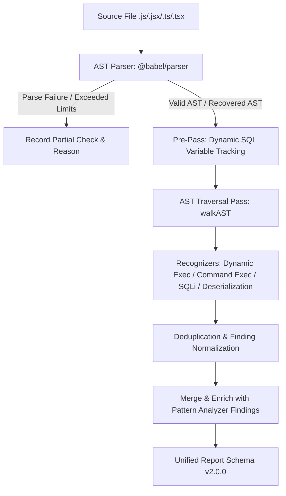

# Luminicent Static Analysis — Phase 5.1 AST-Based JavaScript/TypeScript Static Analysis

## 1. Overview and Architecture

Phase 5.1 introduces structural Abstract Syntax Tree (AST) analysis for JavaScript and TypeScript source files in Luminicent. This provides an offline, syntax-aware static analysis foundation that complements and enriches the existing pattern-based static rules without dynamic execution.

### Architectural Separation

The AST analysis engine is organized into modular components under `backend/utils/ast/`:

```
backend/utils/ast/
├── parser.js       # Safe, bounded AST parsing via @babel/parser
├── traversal.js    # Bounded recursive AST walker and node query utilities
├── recognizers.js  # Structural security pattern detectors for vulnerability categories
├── analyzer.js     # Analysis coordinator, variable tracking, deduplication, metrics
└── index.js        # Public barrel export
```

### Analysis Pipeline Data-Flow



1. **Discovery & File Eligibility**: During static project scanning in `productionAnalyzer.js`, any non-fixture, non-exempt file matching JavaScript and TypeScript extensions (`.js`, `.jsx`, `.mjs`, `.cjs`, `.ts`, `.tsx`, `.mts`, `.cts`) is analyzed by the AST engine.
2. **Parsing Layer**: `parseSource()` in `parser.js` parses the file content using `@babel/parser` v7.29.2 without evaluating or executing the code.
3. **Pre-Pass Scoping & Tracking**: `analyzer.js` conducts a pre-pass to track variable declarations and assignments holding dynamic SQL constructions.
4. **Traversal & Recognizers**: `walkAST()` traverses the AST subject to hard recursion and node limits, invoking recognizers for dynamic execution, command execution, SQL injection, and unsafe deserialization.
5. **Deduplication & Merging**: AST findings are normalized with `origin: 'ast_analysis'` and exact source line/column coordinates. When an issue on `(ruleId, file, line)` is also detected by regex pattern matching, the existing finding is enriched rather than duplicated.
6. **Coverage Integration**: If a syntax error, oversized file, or traversal limit is encountered, the scan does not crash; instead, relevant checks are marked `partial` with an explicit reason code (`ast_parse_syntax_error`, `ast_source_size_limit_exceeded`, or `ast_traversal_limit_exceeded`).

---

## 2. Parser Selection & Backend Dependency Isolation (Phase 5.1.1)

- **Parser**: `@babel/parser` version **7.29.2** (pinned exactly to `"7.29.2"` in `backend/package.json`).
- **Backend Dependency Isolation**: `@babel/parser` is declared directly in `backend/package.json` dependencies and resolved via normal Node.js ECMAScript module resolution (`import { parse as babelParse } from '@babel/parser'`). It does not rely on or resolve through `frontend/node_modules`, ensuring backend deployment independence even when frontend dependencies are absent.
- **Node.js Compatibility**: Fully compatible with Node.js 18, 20, and 24.
- **Language Support**: Comprehensive support for modern ECMAScript, TypeScript, JSX, and TSX.

---

## 3. Supported JavaScript and TypeScript Syntax

The parser configures modern ECMAScript plugins and language dialects:
- **TypeScript**: Full support for `.ts`, `.tsx`, `.mts`, `.cts` files including interfaces, type aliases, generics, and type annotations.
- **JSX & TSX**: React and JSX syntax in `.jsx` and `.tsx` files.
- **Modern ECMAScript Standards**:
  - Optional chaining (`?.`) and nullish coalescing (`??`)
  - Class properties, private methods, and private fields (`#privateField`)
  - Top-level `await`
  - Dynamic `import()`
  - Object rest/spread properties (`...obj`)
  - Async generators and iteration (`for await (...)`)
  - Export extensions (`export ... from '...'`)
  - Numeric separators (`1_000_000`) and BigInt literals
  - Import attributes (`import data from './data.json' with { type: 'json' }`)

---

## 4. Vulnerability Categories Covered

| Category | Rule ID | Title | Recognizer Focus | CWE |
|---|---|---|---|---|
| Dynamic Execution | `LUM-DYN-001` | Dynamic code execution via eval | Direct `eval(...)` and indirect eval `(0, eval)(...)`, `window.eval(...)`, `globalThis.eval(...)` | CWE-95 |
| Dynamic Execution | `LUM-DYN-002` | Dynamic code execution via Function constructor | `new Function(...)` and `Function(...)` invocations | CWE-95 |
| Dynamic Execution | `LUM-DYN-003` | Dynamic code execution via Node.js vm | `vm.runInContext`, `runInNewContext`, `runInThisContext`, `compileFunction`, `new vm.Script` | CWE-94 |
| Dynamic Execution | `LUM-DYN-004` | Implicit code execution via timer string argument | `setTimeout`, `setInterval`, `setImmediate` called with a string argument rather than a callback | CWE-95 |
| Command Execution | `LUM-INJ-002` | Potentially unsafe command construction | `child_process.exec`, `execSync`, `spawn`, `spawnSync`, `execFile` with dynamic expressions or `{ shell: true }` | CWE-78 |
| SQL Injection | `LUM-INJ-001` | Potentially unsafe dynamic SQL construction | Dynamic string concatenation (`+`) or template literal interpolation (`${...}`) passed to `.query()`, `.execute()`, `.executemany()`, `.raw()` | CWE-89 |
| Unsafe Deserialization | `LUM-DES-005` | Unsafe JavaScript object deserialization | `node-serialize.unserialize()`, `serialize.unserialize()`, and direct `unserialize()` | CWE-502 |

---

## 5. Difference: Pattern Detection vs. AST-Based Structural Detection

| Characteristic | Regex / Pattern Matching | AST Structural Analysis |
|---|---|---|
| **Context Awareness** | Text-based; unaware of syntax tree depth, operator precedence, or expression boundaries. | Understands AST hierarchy, distinguishing identifiers, member expressions, binary operations, call arguments, and options objects. |
| **False Positive Resistance** | Can mistakenly match substrings inside complex constructs or misidentify nested arguments. | Verifies callee structure, argument positions, and object literal properties (e.g. `{ shell: true }`). |
| **Safe Pattern Differentiation** | Struggles to distinguish `db.query('SELECT ?', [id])` from dynamic SQL if regexes are overly broad. | Confirms query argument node type (`StringLiteral` vs `BinaryExpression` / `TemplateLiteral`), eliminating false alarms on parameterized SQL. |
| **Source Precision** | Line-based offset calculation. | Precise AST location reporting with both 1-indexed `line` and 0-indexed `column`. |
| **Variable Association** | Limited regex heuristics for nearby assignments. | Pre-pass mapping of variable declarations that contain dynamic SQL syntax, connecting variables to sink call sites. |

---

## 6. Coverage Behavior and Parse Failure Handling

The AST analyzer adheres to fail-safe coverage accounting:
- **Resilient Error Recovery**: When a file contains partial or incomplete code, the parser attempts recovery mode (`errorRecovery: true`), allowing analysis of surrounding valid functions while recording recovered syntax errors.
- **Partial Check Accounting**: If a file suffers fatal non-recoverable syntax errors, the scan **does not crash** or abort scanning of other files. Instead, the analyzer marks affected checks (`dynamic_code_execution_pattern_search`, `sql_injection_pattern_search`, `os_command_injection_pattern_search`, `unsafe_deserialization_pattern_search`) as `partial` with the reason code `ast_parse_syntax_error`.
- **Resource Boundary Limits**:
  - Source file size: Maximum 2 MB (`maxSourceBytes: 2097152`). Files exceeding this limit are skipped with reason `ast_source_size_limit_exceeded`.
  - Traversal depth: Maximum 120 levels (`maxDepth: 120`). Nesting exceeding this limit triggers `ast_traversal_limit_exceeded`.
  - Node traversal count: Maximum 100,000 nodes (`maxNodes: 100000`).
- **No False Clean Status**: A file with syntax errors or exceeded resource limits is never silently marked as clean or fully scanned.

---

## 7. Explicit Limitations & Future Roadmap

> [!IMPORTANT]
> **Source-to-sink taint tracking is not yet implemented.**
>
> Phase 5.1 establishes structural AST pattern recognition. It does **not** perform inter-procedural data-flow analysis, variable alias tracking across function boundaries, taint propagation from HTTP inputs to sinks, or cross-file data tracking.
>
> Consequently:
> 1. An AST finding indicates that a syntactic structure matches a known vulnerable API pattern. It does **not** prove runtime exploitability or attacker control.
> 2. Findings maintain `severityRationale` stating: *"attacker control of input is not established."*
> 3. Future phases (Phase 5.2+) will build upon this AST foundation to introduce intra-procedural scope analysis, symbol resolution, and formal source-to-sink taint tracking.
